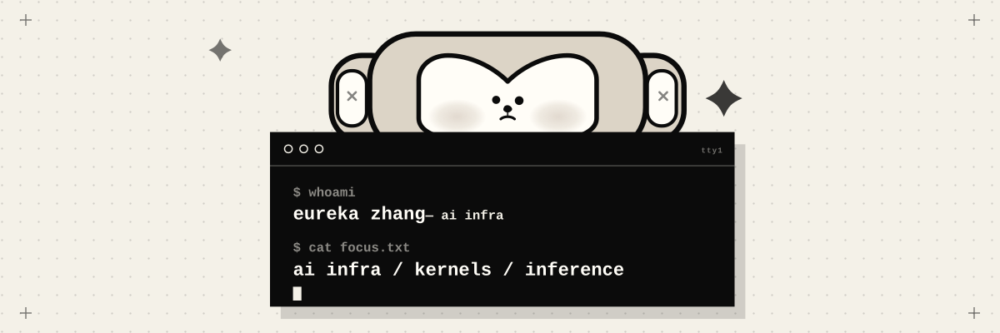
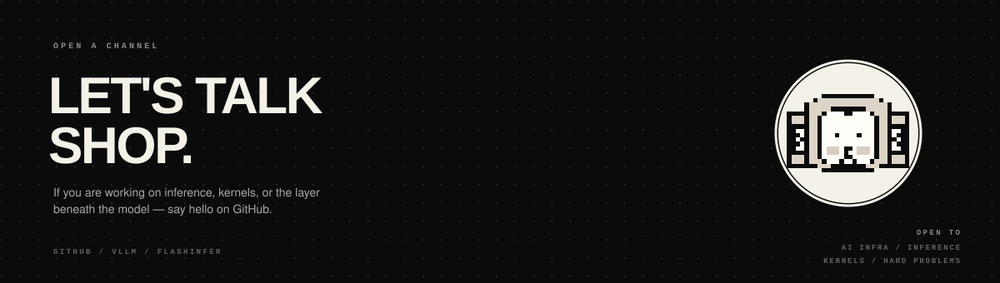

<h1 align="center">Down to the Metal.</h1>

EUREKA ZHANG &nbsp;·&nbsp; AI INFRA

  

 

## 01 / ABOUT

<table>
  <tr>
    <td valign="top" width="54%">
      <strong>I build the layer beneath the model.</strong>
      
M.S. student in Automation at Tsinghua University. I focus on AI infrastructure — inference engines, KV cache, and the CUDA kernels underneath.

    </td>
    <td valign="top" width="46%">
      SKILLS / AI INFRA  
      LANGUAGES 
      <code>PYTHON</code> <code>C++</code> <code>CUDA</code>  
      ML SYSTEMS 
      <code>PYTORCH</code> <code>TRANSFORMER</code> <code>ATTENTION</code> <code>ROPE</code> <code>KV CACHE</code> <code>QWEN</code> <code>TORCH EXTENSION</code>  
      INFERENCE / DEPLOYMENT 
      <code>VLLM</code> <code>SGLANG</code> <code>PAGED ATTENTION</code> <code>PREFIX CACHE</code> <code>CONTINUOUS BATCHING</code> <code>DOCKER</code> <code>CANN</code> <code>TORCH_NPU</code> <code>ASCEND</code>  
      OPTIMIZATION / PERFORMANCE 
      <code>GQA / MQA</code> <code>MOE</code> <code>SPECULATIVE DECODING</code> <code>CORRECTNESS</code> <code>PROFILING</code> <code>LATENCY</code>
    </td>
  </tr>
</table>

---

## 02 / SIGNAL

  

  <a href="https://github.com/Eureka-Zhang"><code>github.com/Eureka-Zhang</code></a>
  &nbsp;·&nbsp;
  <a href="https://github.com/Eureka-Zhang/vllm"><code>vLLM</code></a>
  &nbsp;·&nbsp;
  <a href="https://github.com/Eureka-Zhang/flashinfer"><code>FlashInfer</code></a>

 

  © 2026 EUREKA ZHANG &nbsp;·&nbsp; AI INFRA &nbsp;·&nbsp; BUILT CLOSE TO THE MACHINE

